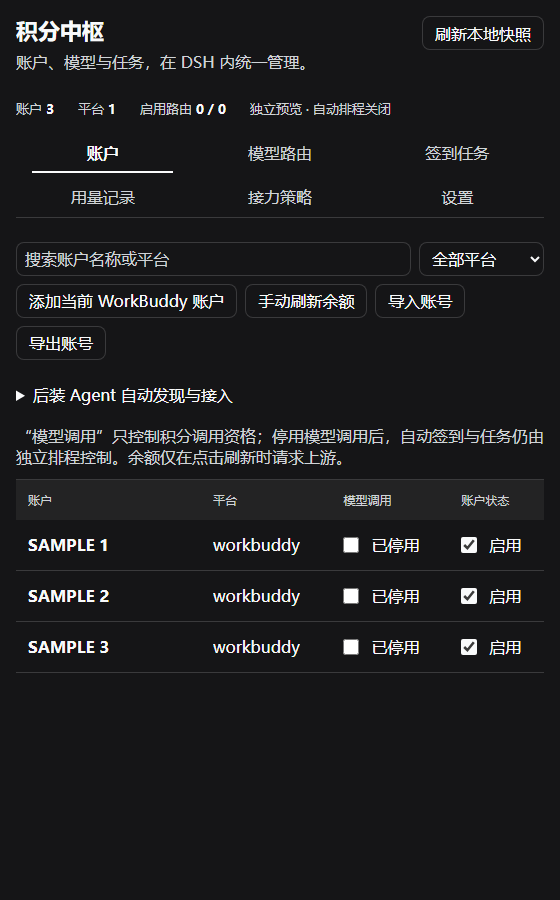
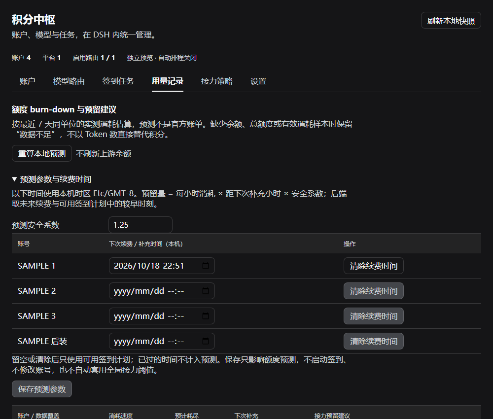

# 积分中枢 · DSH Credit Hub

[](https://github.com/spdw666/dsh-credit-hub/actions/workflows/ci.yml)

**DSH 原生多平台账号、模型路由、错峰签到、事件通知与额度预测插件。** 当前发布版 **0.2.2**。

Native DSH account and model routing management with staggered check-ins, event notifications, and measured quota forecasts.

## 安装

使用 [GitHub Release](https://github.com/spdw666/dsh-credit-hub/releases/latest) 中的预构建包，无需在安装时重新构建前端：

```sh
dsh plugin add https://github.com/spdw666/dsh-credit-hub/releases/latest/download/dsh-credit-hub.tgz
```

也可通过 GitHub 源安装；仓库已提交 `lib/` 与引擎必要预构建文件：

```sh
dsh plugin add github:spdw666/dsh-credit-hub
```

市场条目使用同一稳定 tarball 地址。市场收录须经维护方 PR 审核；仓库有 Release 不等于已经收录。

### 运行条件

- 宿主提供官方 `@deepseek-ai/*` 与 React，不打包或替换一份 DSH。
- 独立 worker 需要 **Node >=22.23.3 且支持 `node:sqlite`**；`package.json` 的 `engines.node` 已是 `>=22.23.3`，更低的 Node 会在安装阶段被拒绝，而不是装好后起不来。优先使用显式配置，其后检测现有 task runtime、DSH 自带独立 Node、PATH。每个候选会真实执行 SQLite 内存查询，Electron 命令包装器不当作独立 Node；没有合格候选时，错误信息会列出探测过的候选及其 Node 版本。
- 默认数据位于 DSH 用户目录的 `plugins/credit-hub`。可通过插件配置指定 `taskRoot`、`configFile`、`nodeExecutable`、`allowScheduler`。
- 部分平台另需其登录态、原生身份或独立运行资产。千问办公的特定编码链额外需要 **Python + cryptography + wasmtime**（可选）；缺少这些条件只影响该平台的编码能力，其他平台管理与其他账号不受影响。

## 使用入口

**DSH 设置 → 积分中枢**，包含账户、模型路由、签到任务、用量记录、接力策略、设置。具备主面板/侧栏能力的版本另有侧栏入口，早期版本使用设置入口。

模型提供方 ID 为 `credit-hub`。本插件拥有独立账号快照、SQLite、刷新缓存与日志，不依赖原 AI 积分网关服务；同一官方账号的额度、限流与令牌状态仍是共享上游状态。

## 主要功能

### 后装 Agent 自动发现

默认每 60 秒检查受支持客户端的已知登录位置。可解析的已登录格式会复制到插件独立目录，识别身份，建立账号/上游，再获取实际模型目录；新路由默认启用，可在账户页关闭。原客户端只读，既有账号开关与路由保持。同一身份更新、不同身份新增，新账号不擅自增加签到任务。

候选包含 WorkBuddy、Trae、千问办公、ZCode、MiniMax、Qoder、CodeBuddy、CodeArts、Cline、LobsterAI、Loomy、小浣熊和 OpenCode 的已知版本路径。未安装、未登录、需要独立配置、已接入及目录失败分开呈现。加密 WorkBuddy、Qoder 原生身份、MiniMax lease、OpenCode 独立服务等条件未满足时不会伪装成已接通。SQLite/WAL 与 Trae 身份元数据纳入内容校验。

### 账号与模型

- 账号启用与模型调用资格分开控制；模型调用关闭不代表签到关闭。
- WorkBuddy 国内/国际 JSON、ZIP、workbuddy-switch JSON 先预览再确认导入，支持选择导出；不将此格式冒充所有平台通用格式。
- 模型目录、账号快照接入和真实调用成功分别记录。
- 接力保留完整 messages、tools、tool IDs/results 与输出预算，不为回退裁剪上下文。

### 错峰签到

每平台配置时间窗口、窗口内持久随机预约、启动补跑分散与全局并发上限。启动仅自动补跑当天从未尝试项；失败、未确认和运行中项不因重启重放。自动/手动共享有界队列，同账号串行，支持“今日未签到”、单个/已选/全部补签。跨午夜及 DST 按真实时区时刻处理。

**自动签到默认关闭**。后台发现和版本检查不等于签到；启用排程、手动补签和任务执行是不同操作。

### 事件 → 通知出口

签到失败、凭据 N 天内过期、余额低于阈值、接力触发、连续三次最终请求失败、版本更新，可映射到 DSH 内通知或通用 Webhook/IM 接收器。事件使用固定脱敏摘要、持久队列、去重与有限重试，不外发 token、原始账号身份或完整上游错误正文。

DSH 隐藏/失焦时保留通知，聚焦显示后确认；这是应用内通知，不冒充操作系统推送。Webhook 以 2xx 确认通用 JSON 信封接收，特定 IM 厂商业务码由接收器转换。Webhook 地址/请求头只存本地私有设置，普通快照不返回这些值。

### 额度 burn-down 与预留建议

按最近七天同单位计费数据，或可比较的余额净下降，计算消耗速度、预计耗尽时间和逐账号预留建议：

```text
预计耗尽小时 = 当前同单位余额 / 每小时可测消耗
建议预留 = 每小时消耗 × 距下次签到/续费小时 × 安全系数
建议比例 = 建议预留 / 已知总额度 × 100%
```

默认安全系数 1.25，可逐账号填写续费/补充时间。至少三个有效样本和 24 小时测量跨度；缺测不填零、Token 不换算积分、充值上升不算负消费、陈旧/过期余额不输出精确耗尽时间。显示覆盖率、来源和假设，不冒充完整官方账单。单账号建议不自动覆盖全局接力阈值，超过原引擎 50% 比例上限会明确提示。

### 版本提醒

默认每小时检测发布包 `repository` 对应的 GitHub `package.json.version`，也支持 HTTPS 清单/npm 元数据。发现更高版本进入事件出口，不后台覆盖运行代码。正式市场用户通过市场更新；`link:` 开发安装可收到版本提醒，但不伪装成市场安装。仅改代码而不递增包版本不算新发布。

## 界面示例

以下是实际 React 管理页和独立引擎使用 **SAMPLE 测试数据**的截图，不是任何用户真实账号：





## 兼容证据

已审计 32 个已知官方 tag（0.1.0-rc.7～0.2.1-rc.2）的源码/API，并逐版执行真实 Typert、LLM、PiAiAdapter 模块契约，保留旧 stream 与新版 snapshot/prepare 分支。13 个早期 tag 使用设置页入口。

这不是 32 个完整历史桌面安装验收。完整桌面实际验收宿主为 0.2.1-rc.2；未来版本按能力检测，不预先声称已实测。公开矩阵位于 `test-fixtures/compatibility-matrix.json`。

## 开发

```sh
npm ci --legacy-peer-deps
npm run sdk:install
npm run build
npm test
npm run test:engine
npm run verify
```

`sdk:install` 只用于开发/CI，安装锁定的官方 SDK；生产宿主提供这些接口。Qwen 离线编码测试可设置 `CREDIT_HUB_TEST_PYTHON` 为装有 cryptography/wasmtime 的 Python；未配置的额外平台测试会明确跳过。CI 会安装这些依赖并执行。

`lib/client.js` 使用官方 `__ModuleLoader__`、slots 与 Connection RPC/Typert，无 iframe。发布包保留预构建客户端和 vendor 核心。构建/测试不需要真实账号或上游生成。

## 派生与许可证

独立包名 `dsh-credit-hub`，并非覆盖原项目。引擎派生自 [spdw666/multi-agent-checkin-dsh](https://github.com/spdw666/multi-agent-checkin-dsh) 0.6.0 的 MIT 核心；原生 UI、隔离 worker、发现/通知/预测/调度与兼容集成为本项目实现。保留原许可证和第三方归属，见 [THIRD_PARTY_NOTICES.md](THIRD_PARTY_NOTICES.md)、`engine/THIRD_PARTY_NOTICES.md` 与 vendor 许可证。

MIT. See [LICENSE](LICENSE).
